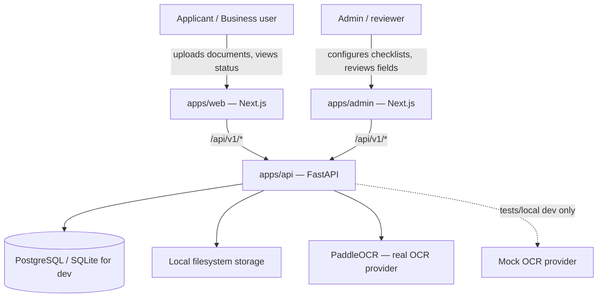
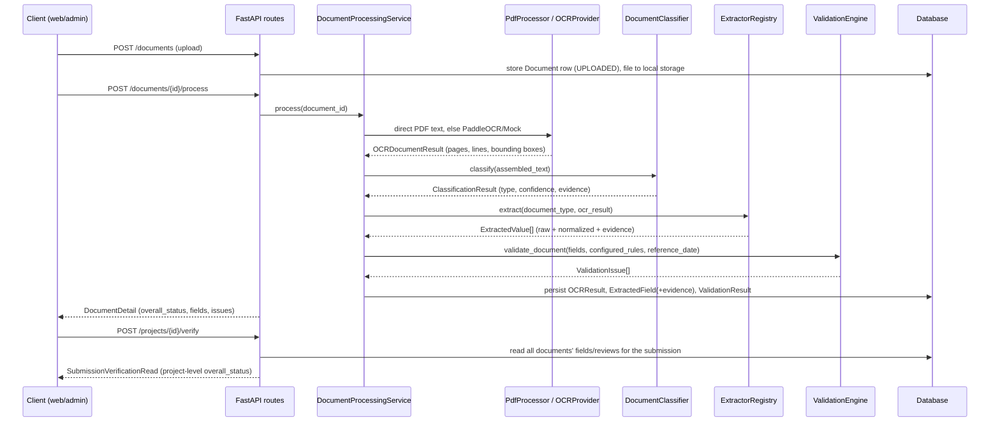
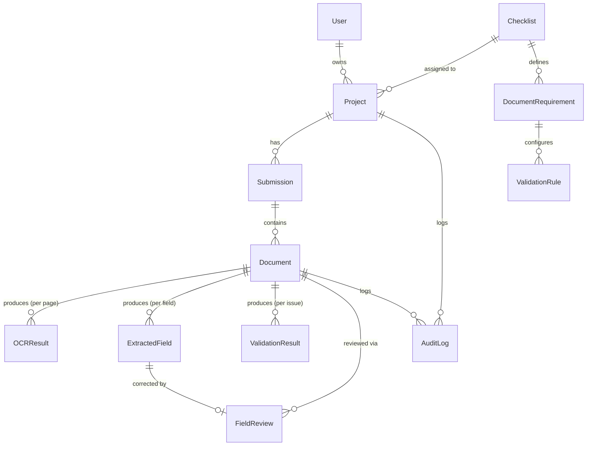
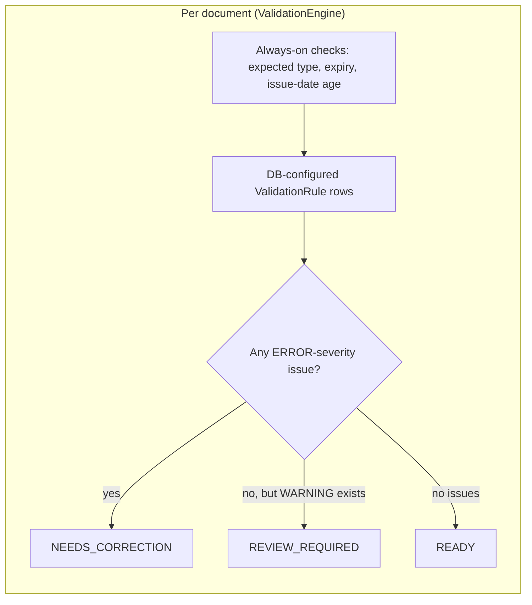
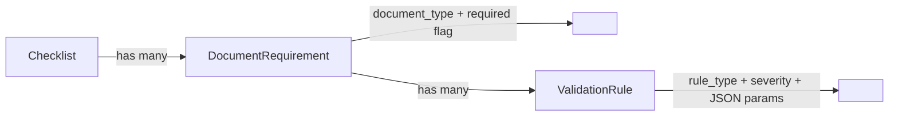

# ADVS Architecture

Verified against commit `f1d949f` on `main` (branch `docs/cleanup-architecture`).
Every claim below was checked against the files it names — see
`evaluation/cleanup/check_docs.py` for the automated version of that check,
and `evaluation/cleanup/REPORT.md` for when this file was last verified.

This supersedes the system-level narrative in `docs/architecture/ARCHITECTURE.md`
(kept, with a pointer back here, for its evidence-conventions detail this file
doesn't repeat) and complements `docs/architecture/DATA_MODEL.md` /
`API_DESIGN.md`, which stay the detailed reference for the schema and routes.

This describes `main` only. Two unmerged branches are deliberately not
reflected here: `p2.2/issue-date-label-gate` and `phase-b/safety-fixes`
(four safety fixes to the required-field net, validity-reference date,
look-alike classification, and company-name notation — see
`evaluation/phase_b/PHASE_B_REPORT.md` on that branch). The "Known
limitations" section below notes, for each relevant item, whether a fix
exists on an unmerged branch.

## 1. System context



No authentication exists anywhere in this system (API, web, or admin) — see
`F-007` in §6. "Admin user" above is a role distinction in the UI only, not
an enforced one.

## 2. Component map

```
apps/api/app/
  api/v1/routes.py              -- all HTTP endpoints (thin; delegate to services/)
  services/
    processing.py                 DocumentProcessingService — coordinates one document's pipeline
    document_validation.py        configured-rule resolution + reference-date plumbing
    requirements.py                per-workflow required-field computation
    verification.py                SubmissionVerificationEngine — project-level status
    reviews.py                     FieldReviewService — human correction workflow
    consistency.py                 cross-document identity/consistency checks
    workflows.py                   Checklist/DocumentRequirement/ValidationRule reads
    storage/local.py               filesystem-backed document storage
  document_intelligence/
    ocr/                          models.py, providers.py (Paddle + Mock), text_assembly.py, worker.py, layout.py
    preprocessing/processor.py    PdfProcessor, ImagePreprocessor, is_meaningful_text
    classification/classifier.py  DocumentClassifier, weighted signal scoring
    extraction/                   base.py + one module per document type, registry.py
    extraction/structural.py      dormant — see §7
    layout/                       dormant P1 structural layout layer — see §7
    normalization/field_normalizer.py
    validation/engine.py          ValidationEngine — per-document rule dispatch
    validation/submission.py      submission-level field comparison (name/company/business-number match)
    evidence_sufficiency.py       EvidenceSufficiencyPolicy
  models/entities.py             SQLAlchemy ORM models (§4)
  schemas/api.py                 Pydantic request/response models
  core/domain.py                 DocumentType, OverallStatus, RuleType, Severity, EXPECTED_FIELDS
```

Each pipeline stage communicates through typed dataclasses
(`OCRPage`/`OCRLine`/`BoundingBox`, `ClassificationResult`, `ExtractedValue`,
`ValidationIssue`) — nothing downstream of OCR touches a raw provider
response, and nothing outside `validation/` re-implements a rule's
pass/fail logic.

## 3. Document pipeline — sequence



An **OCR failure** stops this sequence before classification ever runs
(`Document.processing_status = FAILED`). **`UNKNOWN`** classification means
OCR succeeded but evidence was insufficient to name a type — processing
still completes normally. A **validation failure**
(`NEEDS_CORRECTION`) means classification and extraction both succeeded but
a submission requirement failed (wrong type, expired, name mismatch, a
configured rule). These three are kept structurally distinct in code, not
just in this description.

## 4. Data model (ERD)



`Project.checklist_id` is the single canonical project-to-workflow
relationship — there is no separate `Workflow` table or `workflow_id`
column; `Checklist` *is* the persistence model for the product/API concept
"Workflow" (`services/workflows.py` reads it that way). `FieldReview` has a
partial-unique index (`document_id, field_name` where `is_current = 1/true`)
— exactly one current review per field, enforced in the schema, not just in
application code. `User` exists and is the FK target for `Project.owner_id`
and `AuditLog.actor_id`, but nothing in the API creates, authenticates, or
switches between users (consistent with F-007, §6).

## 5. Decision rules



Status precedence is `NEEDS_CORRECTION > REVIEW_REQUIRED > READY`, computed
independently — but to the same ordering — in both `ValidationEngine.
overall_status` (per document) and `SubmissionVerificationEngine`/
`aggregate_status` (per project, across all of a submission's documents).
Missing/uncertain evidence is a tested invariant, not an incidental
behavior: `_handle_required_field` hardcodes `Severity.WARNING` for a
missing field regardless of what severity a configured rule names,
specifically so a missing field can never become `NEEDS_CORRECTION` on its
own — `test_missing_or_uncertain_value_never_becomes_deterministic_failure`
(`apps/api/tests/test_astra_document_state.py`) pins this. Every
OCR-sourced field additionally routes through `EvidenceSufficiencyPolicy`
before any rule may consume it — a `REVIEW_REQUIRED` evidence state blocks
automatic use regardless of the field's raw confidence score.

`RuleType` has 12 values (`REQUIRED_DOCUMENT`, `REQUIRED_FIELD`,
`DATE_NOT_EXPIRED`, `ISSUE_DATE_MAX_AGE`, `APPLICANT_NAME_MATCH`,
`COMPANY_NAME_MATCH`, `BUSINESS_REGISTRATION_NUMBER_MATCH`,
`DUPLICATE_DOCUMENT`, `EXPECTED_DOCUMENT_TYPE`, `CUSTOM_TEXT_RULE`,
`FIELD_COMPARISON`, `DATE_COMPARISON`, `NUMERIC_COMPARISON`); each dispatches
to one handler function in `validation/engine.py`'s `_RULE_HANDLERS` map.

## 6. Database-driven configuration



"How a rule type behaves" lives in code (`validation/engine.py`); "whether a
rule applies, and with what parameters" lives in the database
(`ValidationRule.params`, a JSON column). A document type is required only
if the active workflow's `DocumentRequirement` row says so — ADVS is
workflow-centric, not globally document-type-required.

## 7. Document types and expected fields

| `DocumentType` | Korean display name | Required fields (`EXPECTED_FIELDS`) | Optional fields (`OPTIONAL_SUPPORTED_FIELDS`) |
|---|---|---|---|
| `GRADUATION_CERTIFICATE` | 졸업증명서 | applicant_name, university_name, department, degree, graduation_date, issue_date | — |
| `CAREER_CERTIFICATE` | 경력증명서 | applicant_name, company_name, position, employment_start_date, employment_end_date, issue_date | — |
| `BUSINESS_REGISTRATION_CERTIFICATE` | 사업자등록증 | company_name, business_registration_number | representative_name, business_address, business_type, business_item, issue_date |
| `SME_CONFIRMATION_CERTIFICATE` | 중소기업확인서 | company_name, business_registration_number, valid_from, valid_until | representative_name, certificate_number, issue_date |
| `NATIONAL_TAX_PAYMENT_CERTIFICATE` | 국세 납세증명서 | company_name, business_registration_number, valid_until | issue_date |
| `SOCIAL_INSURANCE_PAYMENT_CERTIFICATE` | 4대 사회보험료 완납증명서 | workplace_name, business_registration_number, valid_until | issue_date |
| `ENROLLMENT_CERTIFICATE` | 재학증명서 | student_name, university_name, department, student_id, issue_date | — |
| `TRANSCRIPT` | 성적증명서 | student_name, university_name, student_id, issue_date, gpa, gpa_scale | — |
| `UNKNOWN` | 알 수 없는 문서 | none — classification evidence was insufficient to name a type | — |

`SUPPORTED_FIELDS`/`REVIEWABLE_FIELDS` are derived from `EXPECTED_FIELDS`
(same dict, re-exported under a second name) — there is no separate,
independently-maintained field list. A `REQUIRED_FIELD` rule naming a field
outside a type's list is rejected by the API (`400 Unknown
workflow-required canonical field`) rather than silently accepted — observed
directly during this session's Phase A work (attempting `company_name` on
`SOCIAL_INSURANCE_PAYMENT_CERTIFICATE`, which has `workplace_name` instead).

## 8. Frontend architecture

Both frontends are Next.js App Router apps sharing `packages/ui` (primitives)
and `packages/contracts` (TypeScript types generated from the FastAPI
OpenAPI schema via `pnpm contracts:generate` — the backend schemas are the
source of truth, nothing is hand-typed against the API).

- **`apps/web`** (applicant-facing, port 3000): `src/app/projects`,
  `src/app/projects/new`, `src/app/projects/[id]` — project creation,
  document upload, and status viewing. `src/features/{checklists,projects,
  verification,documents,reviews}` hold the data-fetching/state logic per
  domain; `src/components/ui` holds shared presentational components beyond
  what `packages/ui` provides.
- **`apps/admin`** (config/review shell, port 3002): `src/app/{checklists,
  projects,history,rules,document-types}` — one route per configuration
  domain, mirrored under `src/features/`. Per this session's earlier audit
  (`F-008`), it has zero tests — a structural shell, not a complete admin
  product.

## 9. API surface

All routes are under `/api/v1` (`apps/api/app/api/v1/routes.py`):
`GET /health`; `GET/POST/PATCH/DELETE /projects`, `GET /projects/{id}`;
`GET /workflows`, `GET /workflows/{id}`; `GET/POST/PATCH /checklists`,
`GET /checklists/{id}`; `GET /projects/{id}/documents`,
`GET /documents/{id}`, `POST /documents/{id}/process`,
`GET /documents/{id}/processing-status`;
`POST /projects/{id}/verify`, `GET /projects/{id}/verification`;
`GET /projects/{id}/review-items`, `GET /projects/{id}/reviews`, plus one
more `POST` under `/projects/{id}/...` for submitting a review decision.
Full request/response shapes: `docs/architecture/API_DESIGN.md` and
`apps/api/app/schemas/api.py`.

## 10. Dormant code

Two parts of the codebase are real, tested, and reachable only by direct
unit-test import — never wired into the live pipeline:

- **`document_intelligence/layout/`** (`structure.py`, `sections.py`,
  `columns.py`, `headers.py`) — the "P1 structural layout layer." Not
  imported by `extraction/`, `classification/`, or any service.
- **`document_intelligence/extraction/structural.py`** — additive
  "structural candidate" helpers (`header_value_candidate`,
  `section_scoped_candidate`); its own docstring records that a third
  approach, `role_candidate`, "was implemented, measured, and disabled" —
  not re-attempted on the same evidence. Not imported by any extractor.

Both were confirmed unreachable by grep (no importer anywhere in
`apps/api/app/`) as part of this session's audit (`F-014`, a positive
finding: the audit verified the claim of unreachability rather than taking
it on faith) and again during this cleanup pass.

## 11. Known limitations

No async worker/queue (processing is synchronous per request). No
real-world accuracy benchmark for classification/extraction (heuristics
only, measured against a synthetic + recreated benchmark — see
`evaluation/README.md`). Reviewer labels are unauthenticated metadata;
concurrent review replacement is last-write-wins; reviews are not legal or
official approvals.

Cross-referencing this session's independent audit
(`evaluation/system_audit/ADVS_system_audit_report.md`), by severity:

| Finding | Severity | Status on `main` |
|---|---|---|
| F-001 — partial `REQUIRED_FIELD` checklist silently disables the missing-field net for every other field | S0 | Open on `main`. Fixed on unmerged branch `phase-b/safety-fixes` (additive required-field resolution) |
| F-002 — company-name comparison doesn't normalize Korean legal-entity notation | S1 | Open on `main`. Fixed on `phase-b/safety-fixes` |
| F-003 — classifier confidently misclassifies a real unmodeled type into a modeled one | S1 | Open on `main`. Fixed on `phase-b/safety-fixes` (look-alike title guard) |
| F-004 — no checksum validation on Korean business registration numbers | S2 | Open — out of scope for `phase-b/safety-fixes` |
| F-005 — `render_dpi` metadata reports configured, not actual, DPI when a page is downscaled | S2 | Open |
| F-006 — no environment-aware guard on `OCR_PROVIDER=mock` | S3 | Open |
| F-007 — no authentication/authorization anywhere in the API | S1 (production-readiness) | Open |
| F-008 — `apps/admin` has zero tests | S3 | Open |
| F-009 — `security:audit` is a narrow static check, not a vulnerability scan | S3 | Open |
| F-017 — two Python virtualenvs, one incompatible with the pinned Python version | S3 | **Fixed by this cleanup task** — stray `.venv` (Python 3.14) deleted; `.venv312` (the pinned, `Makefile`-used one) kept |
| F-018 — unexplained untracked binary at repo root | Informational | **Resolved** — the items this referred to (`temp`, `txt.txt`) no longer exist |
| F-020 — test-count claim precision | S2 | Not re-checked in this pass |
| F-010 through F-016, F-019 | Positive findings | See the audit report — not defects |

The validity-reference-date instability the audit's companion Phase A work
measured directly (same document, same rules, different server-clock day,
different result) is also fixed on `phase-b/safety-fixes`
(`B-2`/`submission_reference_date`) — not yet on `main`.

## 12. Extension guide

**Add a new document type**: add a `DocumentType` value and its
`EXPECTED_FIELDS` entry in `app/core/domain.py`; add a
`DOCUMENT_TYPE_DISPLAY_NAMES` entry; write an extractor in
`document_intelligence/extraction/<type>.py` and register it in
`extraction/registry.py`; add classifier signals in
`classification/classifier.py`'s `SIGNALS`; add fixtures/gold under
`evaluation/datasets/` + `evaluation/gold/` (see `evaluation/README.md`).

**Add a new validation rule type**: add a `RuleType` value in
`app/core/domain.py`; write a handler function in `validation/engine.py`
and register it in `_RULE_HANDLERS`; if it needs a reference date or other
context, thread the parameter through `validate_document(...)`'s signature
the way `reference_date` already is, rather than reaching for
`date.today()` inside the handler (see §5 and `docs/archive/` for why that
matters — it's the exact defect `phase-b/safety-fixes`'s B-2 fixes).

**Add a workflow/checklist**: this is data, not code — create a
`Checklist` row with `DocumentRequirement` and `ValidationRule` children via
the admin API/UI or `scripts/seed.py`; no deployment is needed for a new
checklist configuration.
