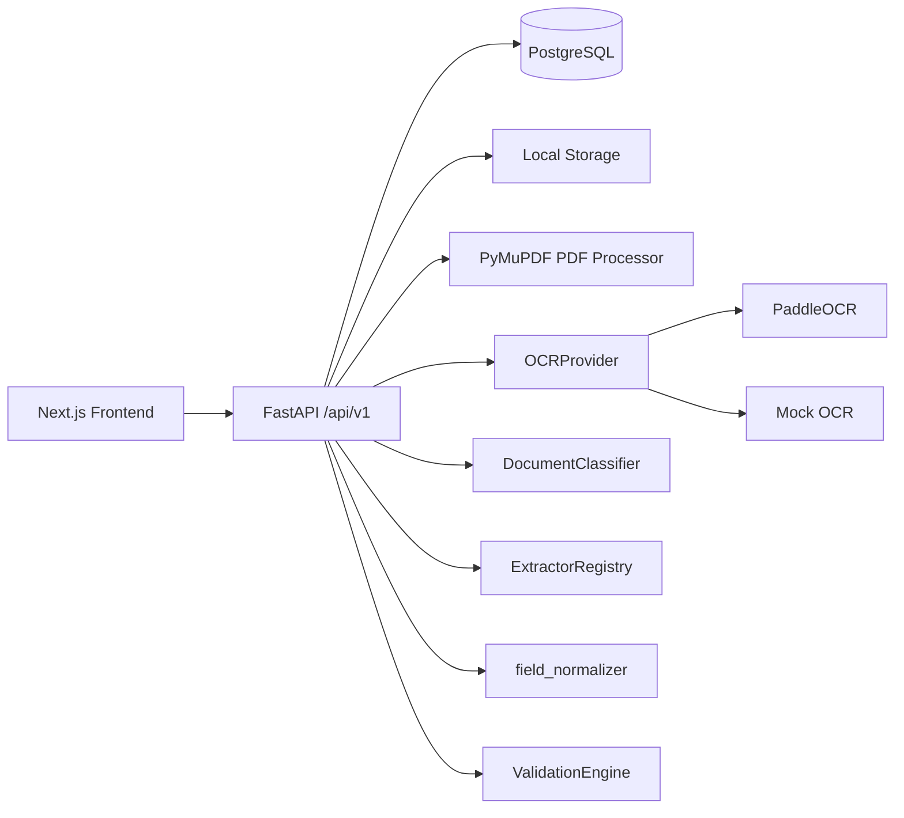

# Architecture



Frontend uses App Router pages and a centralized API client. Backend routes stay thin and delegate to `services/processing.py` (`DocumentProcessingService`), which coordinates -- but does not itself implement -- each pipeline stage. PostgreSQL is the intended database; SQLite is used for local dev/tests only.

## Document intelligence pipeline

```
upload -> file signature/decode validation -> store
  -> PdfProcessor (direct text layer, if meaningful)
  -> OCRProvider (Paddle or Mock) if no usable text layer
  -> OCRDocumentResult (provider-independent: pages, lines, bounding boxes, assembled_text)
  -> DocumentClassifier -> ClassificationResult (type, heuristic score, evidence, alternatives)
  -> ExtractorRegistry -> document-type-specific extractor -> ExtractedValue[]
  -> field_normalizer (dates, business numbers, text) -- used by both extraction and validation
  -> ValidationEngine (always-on checks + DB-configured ValidationRule rows) -> ValidationIssue[]
  -> persist (Document, OCRResult, ExtractedField, ValidationResult)
  -> structured API response (DocumentDetail, including computed overall_status)
```

Module map (`apps/api/app/document_intelligence/`):

```
ocr/            models.py (OCRDocumentResult/OCRPage/OCRLine/BoundingBox, OCRProviderError)
                providers.py (OCRProvider, PaddleOCRProvider, MockOCRProvider)
                text_assembly.py (reading-order line/page assembly)
preprocessing/  processor.py (PdfProcessor, ImagePreprocessor, is_meaningful_text)
classification/ classifier.py (DocumentClassifier, weighted signal scoring)
extraction/     base.py (BaseDocumentExtractor, label-proximity helpers)
                graduation.py / career.py / business_registration.py / sme_confirmation.py
                registry.py (ExtractorRegistry)
normalization/  field_normalizer.py (normalize_date/normalize_business_number/normalize_text_field)
validation/     engine.py (ValidationEngine, ConfiguredRule, rule-type dispatch)
```

Each stage communicates through typed dataclasses (`OCRPage`, `ClassificationResult`, `ExtractedValue`, `ValidationIssue`) -- nothing downstream of OCR touches raw provider responses, and nothing outside `validation/` re-implements a rule's pass/fail logic.

## Error taxonomy vs. UNKNOWN vs. validation failure

These three are kept structurally distinct (see `docs/domains/ocr.md`, `docs/domains/classification.md`, `docs/domains/validation.md` for detail):

- An **OCR failure** (`ProcessingErrorCode.OCR_*`) stops the pipeline before classification ever runs; `Document.processing_status = FAILED`, `classification_confidence`/`classification_meta` stay null.
- **`UNKNOWN`** means classification ran on real OCR output but evidence was insufficient; processing still completes.
- A **validation failure** (`NEEDS_CORRECTION`) means the document was classified and extracted successfully but fails a submission requirement (wrong type, expired, name mismatch, a configured rule).

## Database-driven configuration

`Checklist` -> `DocumentRequirement` (per document type) -> `ValidationRule` (rule_type, severity, JSON params) already existed in the schema; P1 wires `ValidationEngine` to actually consume these rows instead of leaving them unused, while keeping "how a rule_type behaves" in code and "whether/with what parameters it applies" in the database -- ready for a later admin UI to edit checklist rules without a code change.

## Known limitations

No async worker/queue (processing is synchronous per request); no real-world accuracy benchmark for classification or extraction yet (heuristics only, measured against a synthetic benchmark -- see `evaluation/README.md` and `evaluation/reports/`); admin app remains a structural shell; no auth/RBAC.
