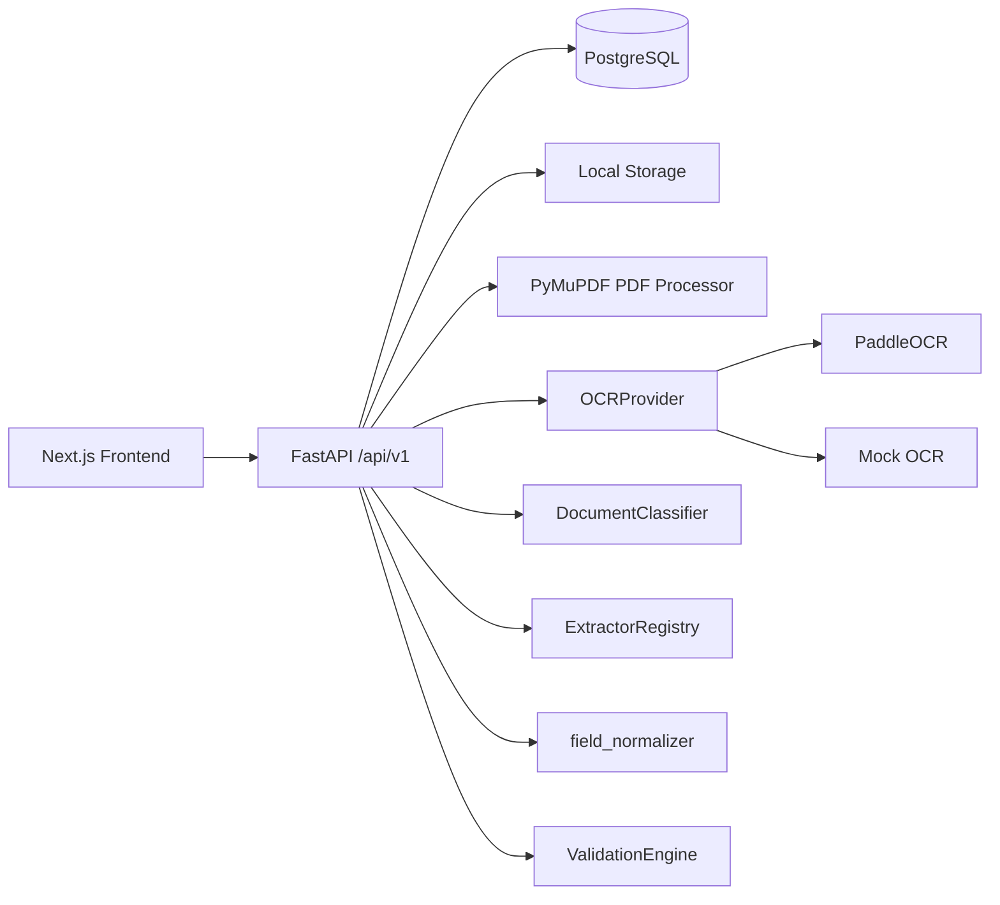

# Architecture



Frontend uses App Router pages and a centralized API client. Backend routes stay thin and delegate to `services/processing.py` (`DocumentProcessingService`), which coordinates -- but does not itself implement -- each pipeline stage. PostgreSQL is the intended database; SQLite is used for local dev/tests only.

## Document intelligence pipeline

```
upload -> file signature/decode validation -> store
  -> PdfProcessor (direct text layer, if meaningful)
  -> OCRProvider (Paddle or Mock) if no usable text layer
  -> OCRDocumentResult (provider-independent: pages, lines, bounding boxes, assembled_text)
  -> DocumentClassifier -> ClassificationResult (type, heuristic score, evidence, alternatives)
  -> ExtractorRegistry -> document-type-specific extractor -> ExtractedValue[]
  -> field_normalizer (dates, business numbers, text) -- used by both extraction and validation
  -> ValidationEngine (always-on checks + DB-configured ValidationRule rows) -> ValidationIssue[]
  -> CanonicalDocumentResult (identity/type, fields, missing expected fields, state/issues)
  -> persist (Document, OCRResult, ExtractedField + field evidence, ValidationResult)
  -> structured API response (DocumentDetail, including computed overall_status)
```

Module map (`apps/api/app/document_intelligence/`):

```
ocr/            models.py (OCRDocumentResult/OCRPage/OCRLine/BoundingBox, OCRProviderError)
                providers.py (OCRProvider, PaddleOCRProvider, MockOCRProvider)
                text_assembly.py (reading-order line/page assembly)
preprocessing/  processor.py (PdfProcessor, ImagePreprocessor, is_meaningful_text)
classification/ classifier.py (DocumentClassifier, weighted signal scoring)
extraction/     base.py (BaseDocumentExtractor, label-proximity helpers)
                graduation.py / career.py / business_registration.py / sme_confirmation.py
                registry.py (ExtractorRegistry)
normalization/  field_normalizer.py (normalize_date/normalize_business_number/normalize_text_field)
validation/     engine.py (ValidationEngine, ConfiguredRule, rule-type dispatch)
```

Each stage communicates through typed dataclasses (`OCRPage`, `ClassificationResult`, `ExtractedValue`, `ValidationIssue`) -- nothing downstream of OCR touches raw provider responses, and nothing outside `validation/` re-implements a rule's pass/fail logic.

### Canonical result and provenance

`CanonicalDocumentResult` is the document-intelligence read model composed from the existing
pipeline types. It does not duplicate the `Document` database entity. It carries the document ID,
classified type and honest heuristic confidence, canonical `ExtractedValue` fields,
expected-but-unresolved field names, processing state, and optional verification/issues metadata.
The document-detail API is its persisted/read-side representation.

An extraction fact, its supporting evidence, and a validation decision are separate concepts:

- `ExtractedValue` is an interpretation with a canonical field name, raw value, normalized value,
  optional field confidence, and evidence references.
- `EvidenceRef` is the provider-independent observation supporting that interpretation.
- `ValidationResult` remains the outcome of a rule. Missing extraction evidence does not by itself
  assert that the source document lacks the information and does not automatically select a final
  verification status.

A value without provenance is harder to trust, debug, and review. New pipeline results therefore
retain field-level evidence; historical rows may legitimately have `evidence = null`.

Evidence conventions:

- `page_number` is always 1-based and is never hard-coded to the first page.
- `source_text` is the actual supporting OCR or embedded-text line, not cleaned display text.
- `bounding_box` uses `{x, y, width, height}`, top-left origin, x-right/y-down. `coordinate_space`
  is `pixel` for OCR and `pdf_point` for embedded PDF text. Paddle polygons are explicitly reduced
  to their axis-aligned enclosing rectangle by the provider adapter.
- `confidence` is the original line/source confidence. Direct PDF text has null confidence; the
  pipeline does not invent `1.0`.
- A field supported by multiple lines uses the minimum available supporting-line confidence. This
  deliberately prevents a high page average from hiding a weak supporting observation.

## Error taxonomy vs. UNKNOWN vs. validation failure

These three are kept structurally distinct (see `docs/domains/ocr.md`, `docs/domains/classification.md`, `docs/domains/validation.md` for detail):

- An **OCR failure** (`ProcessingErrorCode.OCR_*`) stops the pipeline before classification ever runs; `Document.processing_status = FAILED`, `classification_confidence`/`classification_meta` stay null.
- **`UNKNOWN`** means classification ran on real OCR output but evidence was insufficient; processing still completes.
- A **validation failure** (`NEEDS_CORRECTION`) means the document was classified and extracted successfully but fails a submission requirement (wrong type, expired, name mismatch, a configured rule).

## Database-driven configuration

ADVS is workflow-centric: a document type is not globally required. An active `Checklist` is the persistence model for a product/API **Workflow**, and each workflow owns `DocumentRequirement` rows with an explicit required/optional flag. `Project.checklist_id` is the single canonical project-to-workflow relationship; a duplicate `Workflow` table or `workflow_id` database column is intentionally avoided.

`Checklist` -> `DocumentRequirement` (per document type) -> `ValidationRule` (rule_type, severity, JSON params) already existed in the schema; P1 wires `ValidationEngine` to consume these rows, while keeping "how a rule type behaves" in code and "whether/with what parameters it applies" in the database. The workflow API and project reads expose expected documents so the frontend does not reconstruct requirements.

The target business workflow will use 사업자등록증 as its reference identity and later compare company documents and validity periods. The target student workflow will later apply issue-date checks and configurable conditions. Those extractors and cross-document rules are not implemented in Phase 1.

## Known limitations

No async worker/queue (processing is synchronous per request); no real-world accuracy benchmark for classification or extraction yet (heuristics only, measured against a synthetic benchmark -- see `evaluation/README.md` and `evaluation/reports/`); admin app remains a structural shell; no auth/RBAC.
