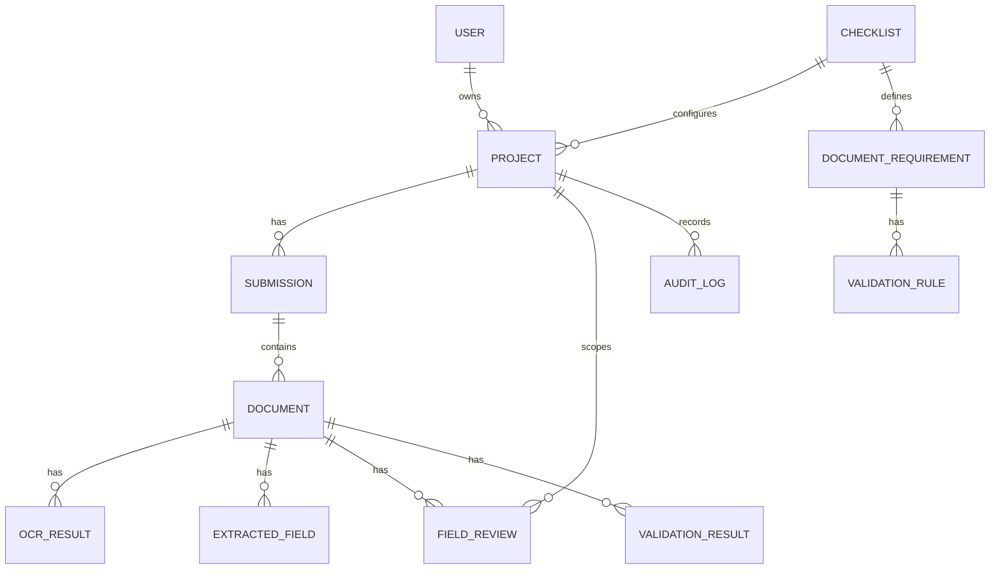

# Data Model

Entities: User, Project, Checklist, DocumentRequirement, ValidationRule, Submission, Document, OCRResult, ExtractedField, FieldReview, ValidationResult, AuditLog. UUID primary keys and timestamps are used throughout.

`ValidationResult.scope=SUBMISSION` identifies the latest project-level verification rows.
`outcome` stores `PASS`, `FAIL`, `UNRESOLVED`, or `NOT_APPLICABLE`; `details` stores only
structured rule/document/field references and evaluation metadata, not copied OCR payloads.

`ExtractedField.evidence` is nullable JSON containing the minimal source observations supporting
the field (`page_number`, original `source_text`, optional rectangle, optional source confidence,
source kind, and coordinate space). Nullable storage preserves historical records for which the
pipeline did not capture provenance. Full page images and binary OCR payloads are not stored here.

`FieldReview` targets a document plus canonical field name and optionally references the current
`ExtractedField`. It snapshots the original machine raw/normalized values, stores corrected values
separately, records reviewer label/note/timestamps, and binds the decision to
`Document.processing_version` and an evidence-policy version. A partial unique index permits only
one current review per document/field while superseded and stale rows remain auditable. A SHA-256
fingerprint binds the decision to its original evidence without copying OCR text into the review.

Important indexes cover project ownership, document checksum, document type, processing status, checklist requirements, and validation codes.

`Checklist` is the persistence name for the user-facing Workflow concept. `Project.checklist_id` remains nullable only for backward compatibility with existing projects; all new project API requests require an active `workflow_id`, which is stored in that column. Document requirements are scoped to a checklist and carry `required=true|false`, so no document type is universally required.
