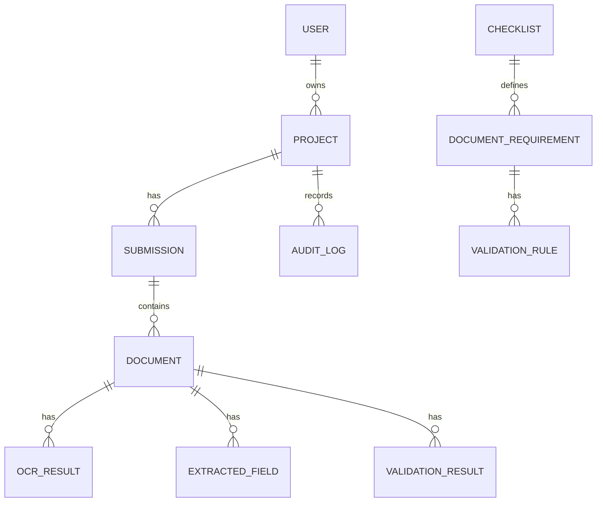

# Data Model

Entities: User, Project, Checklist, DocumentRequirement, ValidationRule, Submission, Document, OCRResult, ExtractedField, ValidationResult, AuditLog. UUID primary keys and timestamps are used throughout.

Important indexes cover project ownership, document checksum, document type, processing status, checklist requirements, and validation codes.

