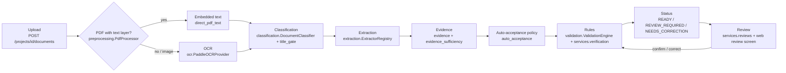

# ADVS — pipeline summary

Code lives under `apps/api/app/` (`document_intelligence/` for the stages, `services/` for the workflow, `api/v1/routes.py` for HTTP). The web app only renders API responses and Korean copy (`apps/web/src/lib/presentation.ts`); it holds no validation logic.

1. **Upload.** The file is stored and hashed; a duplicate upload is ignored with a notice. `POST /documents/{id}/process` runs the pipeline (`services/processing.py`, `DocumentProcessingService`).
2. **Text: embedded or OCR.** A PDF with a usable text layer is read directly (PyMuPDF, reading order rebuilt from coordinates). Scans and images go through PaddleOCR (Korean models, one bounded worker per process; the model is warmed up at API start).
3. **Classification.** Rules over title and structure signals pick one of the six supported types or UNKNOWN. For OCR text a title gate requires a clean title (or two independent identifiers), so a garbled look-alike such as a 지방세 certificate stays unclassified instead of becoming a 국세 certificate.
4. **Extraction.** One extractor per document type reads the fields by label and position; each value keeps its raw text, normalised value and confidence.
5. **Evidence.** Every value records where it came from (page, source kind: embedded text or OCR, source text). A value counts as sufficient only with such evidence.
6. **Auto-acceptance policy.** Embedded-text values are used directly. An OCR value is accepted without a person only when an independent source confirms it (another document, the application value, or a second differently-preprocessed read for check-digit numbers); dates, GPA and student numbers are never confirmed by a second read alone, and values near a decision boundary go to a person. Each decision keeps its reason (`auto_acceptance` on the field) — shown as a badge in the UI.
7. **Rules.** The workflow checklist drives required documents, validity dates, cross-document comparisons (with company-name notation normalised), and the student rules (90-day issue date, student number). Missing or unestablished documents outrank everything.
8. **Status.** The worst effect wins: 보완 필요 over 확인 필요 over 제출 가능. 제출 가능 means no blocking issue in the configured pre-check — not official approval.
9. **Review.** Values still unconfirmed appear in a queue with the machine value, the reason, and the evidence. A confirm/correct decision is stored per field; the submission is then re-checked ("자동 점검 실행") and the status refreshes.
