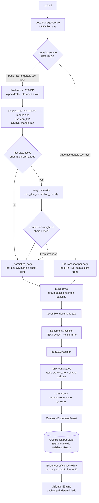

# Backend architecture AFTER the audit

Every stage below exists because a specific measured failure required it, or
because it was already correct and is retained deliberately. Nothing was added
speculatively.

## 1. Final pipeline



## 2. Why each stage exists

| Stage | Reason it exists | Evidence |
|---|---|---|
| **Per-page routing** | A document-level gate made one digital page suppress OCR for every scanned page in the same file, silently losing all of their fields. | E4 |
| **288 DPI rasterization** | At PaddleOCR's 144 DPI default the letter-spaced title was split and one fragment misread, so the strongest classification signal vanished. | E1 |
| **Conditional orientation retry** | Rotation is a real capture condition with zero prior support, but enabling orientation classification *unconditionally* regressed upright documents from 0.933 to 0.717 confidence. A retry only fires when the first pass already looks damaged. | E2 |
| **`build_rows`** | The decisive fix. A letter-spaced label arrives as 2–5 separate boxes; matching labels against reconstructed whole lines meant `성명` never existed as a string. | E3 |
| **Candidate generation + ranking** | "First match wins" returned the *secondary* major when the primary's label was split, and had no way to prefer a valid candidate over an invalid one. | E3 |
| **Shape validation** | A footnote fragment became `university_name` with confidence 0.908 — above the 0.90 trust floor, so it was marked `SUFFICIENT`. | E3 |
| **Text-only classification** | The filename was part of the matching haystack, so a document could be classified by what it was called. | E6 |
| **Page-scoped rows** | A bare label at the end of page 1 paired with the first text of page 2, fabricating a value with two-page evidence. | E5 |

## 3. Fallback behaviour

1. **Page with a usable text layer** → embedded text, exact characters, no OCR
   error, `confidence=None`, bbox in PDF points.
2. **Page without one** → rasterize at 288 DPI → PaddleOCR.
3. **Degraded first pass** → one orientation retry; the better of the two
   passes wins. A retry error is swallowed and the first pass is kept — a retry
   can never turn a usable result into a failure.
4. **No shape-valid candidate for a field** → `null` with `needs_review=True`.
   Never a guess.
5. **Type is `UNKNOWN`** → the extractor registry is not consulted at all. No
   field is invented.
6. **OCR raises** → the existing `OCRProviderError` taxonomy still applies;
   status becomes `FAILED` with a coded error.

## 4. Abstention behaviour (the safety property)

An impossible candidate is **rejected, never repaired**. Concretely, the
signature block `경 / 북 / 대 / 학 / 교` followed by overlapping seal text
yields `university_name = null`, because the row tail `총` is not a valid
institution. The system declines rather than guessing — and, critically, it
decline *before* the value could acquire an evidence confidence that would
satisfy the trust floor.

The asymmetry is deliberate throughout:

```
confident wrong value   >>  explicit unresolved value
```

because a wrong populated value can silently satisfy verification, while an
unresolved value is routed to a human.

## 5. Evidence

`EvidenceRef` is unchanged and still records page number, source text, bounding
box, confidence, `source_kind` (`ocr` | `embedded_pdf_text`) and
`coordinate_space` (`pixel` | `pdf_point`).

One improvement: evidence now references the **specific detected boxes** that
produced the label and the value, rather than one reconstructed line. For
`성` + `명:홍길동` the evidence is two entries, each with its own bbox and
confidence. Field confidence remains the conservative **minimum** across them.

Invariant now enforced by test: **a populated field's evidence never spans two
pages.**

## 6. Review

`EvidenceSufficiencyPolicy` (`evidence-policy-v1`) is **unchanged**. The `0.90`
OCR floor was not tuned to make examples pass; the lesson of this audit is that
an OCR confidence floor is a weak signal, and the real improvement came from
not producing impossible values in the first place.

Review is now *more* accurate rather than more frequent: on the real document
the correct student name is auto-accepted while the impossible university name
is flagged, which is strictly better than the previous state where a garbage
value passed as `SUFFICIENT`.

## 7. Verification boundary — unchanged

`ValidationEngine` and `submission.py` are **untouched**. Verification remains
fully deterministic and model-free. Unresolved fields surface as review, never
as false deterministic failures. No extraction or confidence logic was moved
into verification, and no semantic/model decision may enter it.

## 8. Known limitations after this work

These are real and were measured, not assumed:

- **Rotation is only partially handled.** A 90°-rotated copy improved
  (243 → 367 recognized chars) but still classifies as `UNKNOWN`.
- **No real-document corpus.** One authorised real document. Per-field
  ground truth covers 2 of 5 fields. No confusion matrix, no CER/WER, no
  per-type statistics for real data — all `NOT_EVALUATED`.
- **Tables are still not modelled.** A key/value grid is still just rows of
  text. `PP-StructureV3` would be the fix and is not yet adopted.
- **No deskew, no dewarping, no perspective correction for phone photos.**
  `ImagePreprocessor` remains unused dead code and should be either wired in
  with evidence or deleted.
- **Signature-block values are not recoverable** by generic geometry alone.
  Needs a layout-anchored or template-family extractor.
- **Six of eight supported document types are untested against any real
  document.**
- Business-registration-number checksum validation was **not** added: no
  authoritative Korean checksum algorithm was confirmed, and inventing one
  would be unsafe.
